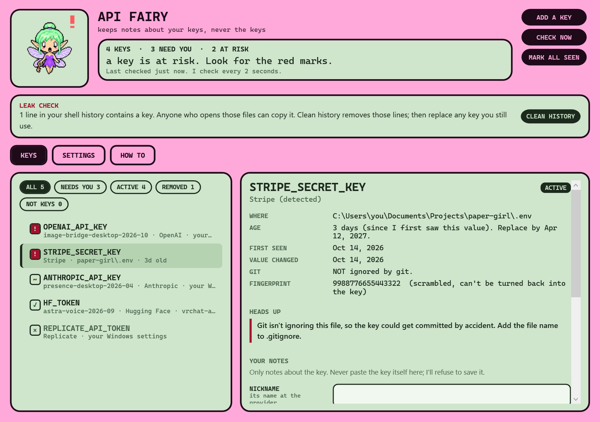

# API Fairy

*A pet app by Astra.*

API Fairy keeps track of your API keys on Windows. When you add, change or remove a key, she tells you: her desktop pet (drawn by Startup Star, with the other pets) says it in a bubble, and Windows shows a notification. Click either one and a window opens with everything she knows about every key: which provider it belongs to, where it lives, how old it is, what uses it, and whether anything about it is risky.



She keeps notes **about** your keys, never the keys themselves.

## What she watches

- **Windows environment variables**, for your account and for the whole PC. This is where `OPENAI_API_KEY`-style keys usually live.
- **`.env` files** in the folders you choose (by default `Documents\Projects`), including subfolders up to 6 levels deep.
- **Your shell history** (PowerShell and Git Bash). Typing a key into a command saves it there in plain text, so she checks for that too.

She checks every 2 seconds and speaks up when a key is **added**, **changed**, or **removed**.

## What she tells you

For each key: the provider (recognized from the key's shape or its name), where it is, when she first saw it, when its value last changed, its age, and your own notes (nickname, what uses it, spending limit, created date).

She flags risks in red:

- a `.env` file that git isn't ignoring, or that's already committed
- a real-looking key inside an example file like `.env.example`
- a key saved in your shell history (with a button to clean it out)

And gentler warnings for keys older than 6 months (you can change this), the same key used in two places, `.env` files that sync to OneDrive, and keys stored in system-wide settings.

## Use it

1. Double-click **Start API Fairy.cmd**. The first time, it builds the app with the C# compiler that comes with Windows (a few seconds, nothing downloaded).
2. API Fairy's icon appears in the taskbar tray, and Windows says hello. Click the icon (or the notification) to open the window. On the desktop, the API Fairy that Startup Star shows is the same fairy.
3. Click her to open the window. In **Settings**, tick **Start with Windows** so she never misses a new key.

To add a key the safe way, click **ADD A KEY**. Windows opens its own Environment Variables window; add the key under **User variables**, and she'll pop up within a couple of seconds.

### If your antivirus blocks it

A freshly built app has no signature or reputation yet, so some antivirus tools (Malwarebytes especially) may quarantine `API Fairy.exe` as "MachineLearning/Anomalous". That's a false positive: every line of the app is in `src/`, and you built it yourself. To allow it in Malwarebytes: **Detection History → Allow List → Add → Allow a file or folder**, and pick `bin\API Fairy.exe` (and `bin\tests.exe` if you run the tests). Then run `Start API Fairy.cmd --rebuild`.

## Limits

What is not done or not verified yet (2026-10-17):

- **First run on Astra's PC: 2026-10-17**, after Malwarebytes was told to allow `bin\`. Before that, Malwarebytes quarantined every build ("MachineLearning/Anomalous.100%", "Trojan.Crypt.MSIL"): false positives for unsigned programs that use Windows encryption. Tests: 83 of 83 pass.
- **The desktop pet's bubble needs Startup Star.** API Fairy writes what to say to `%LOCALAPPDATA%\astras-pet-os\api-fairy-ring\desktop-signal.json` (moods and key names only). Until Startup Star reads that file (handoff card 018 in astras-pet-os, for Codex), the Windows notification is how she tells you.
- She checks only while she is running. "Start with Windows" exists as a setting but has never been turned on.
- No weekly stale-key report yet; ages and warnings show only in the window.
- The `api-fairy-mushroom-circle` tool from Astra's PetOS (short-lived agent keys from Iron Gates) is not built; Iron Gates does not exist yet.
- The browser notebook (`api-fairy-20261008.html`) is a separate offline page. It does not scan anything and does not share data with the desktop app.
- The app is not code-signed.

## How it keeps your keys safe

- **The key never leaves the moment.** Values are read into memory only long enough to recognize the provider and make a scrambled fingerprint, then dropped. They're never stored, shown, logged, copied, or sent anywhere.
- **Fingerprints can't be reversed.** A fingerprint is an HMAC-SHA256 with a random secret that only exists on your PC, cut to 16 characters. It lets the fairy notice when a key changes or appears twice, and nothing more.
- **Notes are encrypted** with Windows DPAPI for your account, in `%LOCALAPPDATA%\API Fairy`, a folder locked to your account. Other accounts, other PCs, and backups can't read them.
- **No internet code at all.** A test fails the build if network code is ever added. The only web pages she opens are a fixed list of provider key pages (like `platform.openai.com/api-keys`), when you click **MANAGE**.
- **No dependencies.** Built from source with the compiler that ships with Windows. No packages, nothing downloaded.
- **She refuses to save a key in your notes**, even by accident.
- **Runs as you, never as admin.** The fairy can't take focus away from what you're typing.

More detail in [SECURITY.md](SECURITY.md).

## Develop

```bat
build.cmd test
```

This builds the app and the tests, then runs the tests. `bin\API Fairy.exe --snapshot docs` redraws the README pictures with made-up keys.

Code map:

| File | What it does |
|---|---|
| `src/Providers.cs` | Recognizes keys by their shape and name, and knows each provider's key page |
| `src/Dotenv.cs` | Reads `.env` files |
| `src/Scanner.cs` | Looks in Windows settings, `.env` files, and shell history; makes fingerprints; asks git about `.env` files |
| `src/Core.cs` | Decides what changed, what's risky, and what the fairy says |
| `src/Store.cs` | The encrypted notes file |
| `src/Art.cs` | Her approved mood frames (`art/`), built into the program, and the app icon |
| `src/DesktopSignal.cs` | Tells Startup Star's desktop API Fairy what to say |
| `src/DashboardWindow.cs` | The main window |
| `src/App.cs` | Startup, the background checks, and the tray icon |

## Credits

Made by Astra. The fairy's handheld is a cousin of Chip from Data Dealer. MIT licensed.

## Browser interface · 2026-10-08

Open [api-fairy-20261008.html](api-fairy-20261008.html) in a modern browser. The dated browser entry is an offline API credential-metadata notebook. It stores labels and rotation notes, never API key values, and does not scan files. The existing Windows desktop implementation remains under src/. Its scanner and background checks are separate from this browser interface.

Current Cage artwork is bundled in `art/` and indexed in `sprite-20261008.json`. Private records, tokens, logs and local machine metadata must stay outside Git.

Source version `0.1.0-20261008`, tag `v0.1.0-20261008`. Publication checks are recorded in `docs/publications-20261008.md`; source publication does not establish live hosting.

Desktop appearance draft updated 2026-10-11: see [desktop details](desktop-pet-20261011.json). This changes the desktop pet, not application features.
